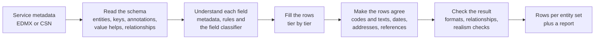
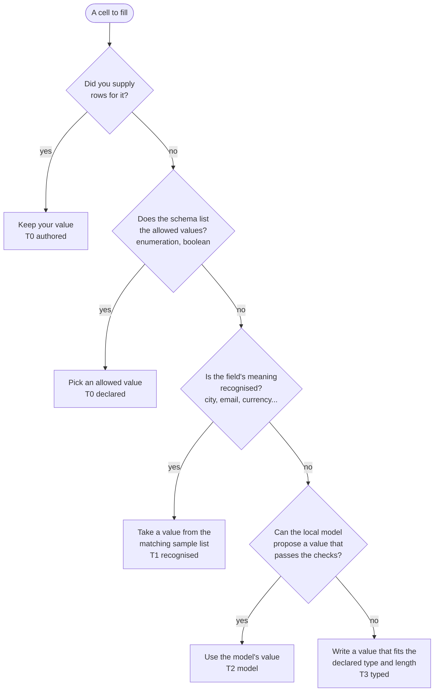
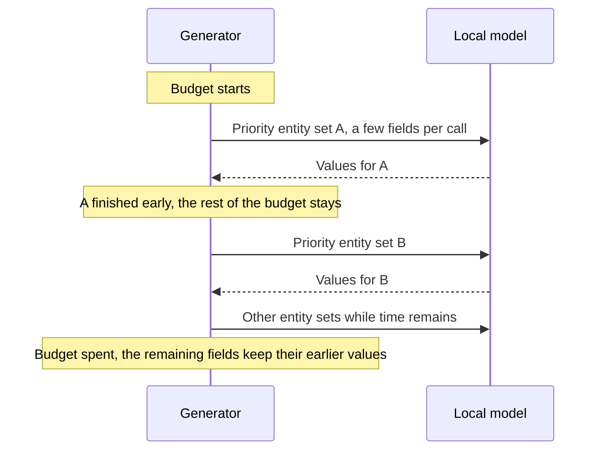
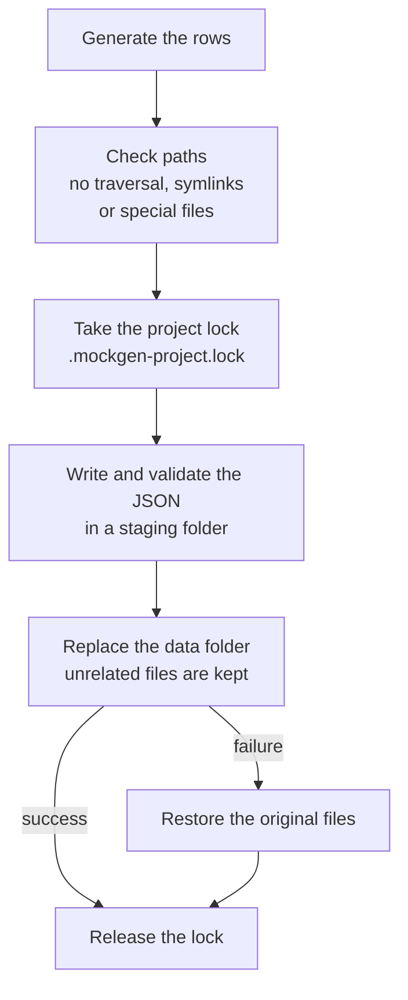
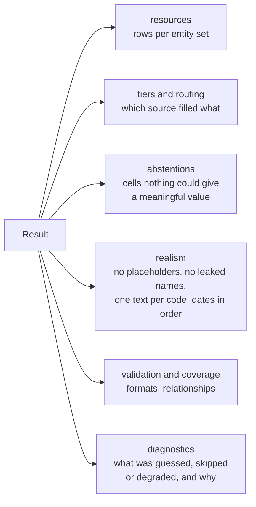
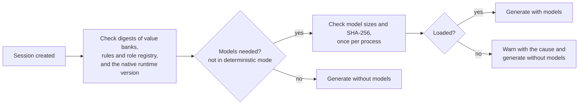

# `@sap-ux/mock-data-generator`

Create realistic test data for an OData service, on your own machine, without a backend and without sending anything to the cloud.

You give it the service metadata (EDMX or CSN). It gives you rows for each entity set: names that look like names, dates in the right order, codes with matching texts, and references that point to rows that exist. Everything runs offline. The package ships with a small field classifier, a small local language model and curated lists of sample values.

## What it does, in short

- Reads your service metadata and works out what each field is for (a city, an email, a status code, an amount...).
- Fills each field from the most trustworthy source it has, from your own data down to a safe default.
- Keeps rows consistent: a text belongs to its code, a start date comes before its end date, a foreign key points to a real row.
- Checks the result before handing it back, and tells you where a value is only a best guess.
- Can write the data straight into an application's mock data folder, safely.

## How it works



### Where each value comes from

Every cell is filled by the first source that has a good answer. The sources are called tiers, and the result tells you how many cells each tier filled.



Keys and foreign keys are generated so that every reference resolves. When nothing knows what a text field holds, it gets the value the standard SAP Fiori elements mock server would write, the property name and the row number (`BankNumber_3`). That is honest: it says plainly that the value is a placeholder, instead of pretending to be real.

### The local model and its time budget

The language model is the slowest part, so it only fills what the earlier tiers could not, and it runs inside a time budget. Code lists the model writes go first, because other fields refer to them; then the entity sets the host names in `sftPriorityTargets` (an editor passes the ones the application displays); then the rest, smallest first. Each entity set may use what is left of the budget, and stops as soon as its fields are done, so the time it does not need goes to the next one. The model writes a few fields per call, so even a slow machine finishes some calls instead of none. Whatever the model does not reach keeps its earlier value.



The model's answers are kept in memory, and optionally on disk (`answerCacheDirectory`), so the same request is answered again without running the model.

## Quick start

```ts
import { createMockDataGenerator, generateProjectData } from '@sap-ux/mock-data-generator';

const generator = await createMockDataGenerator();
try {
    const result = await generator.generateService(request, {
        mode: 'auto',
        rowsPerEntity: 10,
        seed: 1
    });
    // result.resources contains rows keyed by entity set.
} finally {
    await generator.dispose();
}

await generateProjectData({
    projectRoot: '/absolute/application/path',
    dataDirectory: 'webapp/localService/mockdata',
    request,
    options: { rowsPerEntity: 10, seed: 1 }
});
```

`request` holds the metadata, the service identity, the entity sets to fill, any rows you already have, and an optional cancellation signal. `generateService()` and `inspectService()` are also exported as one-shot functions that clean up after themselves. `getMockDataGeneratorInfo()` tells you the public API version (`apiVersion: 2`, which hosts pin), the package and model identity, and the native runtime it needs, without loading anything.

### Modes

| Mode            | What it uses                                                                               |
| --------------- | ------------------------------------------------------------------------------------------ |
| `deterministic` | Metadata, rules and sample lists only. Fast, the same output every time for the same seed. |
| `learned`       | Adds the field classifier and the local model.                                             |
| `auto`          | Uses the models when they are available and falls back to deterministic otherwise.         |

### Common generation options

| Option                               | What it does                                                                    |
| ------------------------------------ | ------------------------------------------------------------------------------- |
| `rowsPerEntity`                      | Rows per entity set: one number, or a number per entity set.                    |
| `seed`                               | Same seed, same deterministic values.                                           |
| `referenceDate`, `windowYears`       | The calendar window dates are drawn from (`YYYY-MM-DD`, and 1 to 100 years).    |
| `sftBudgetMs`, `sftTimeoutMs`        | Time the local model may use for the whole service, and for one entity set.     |
| `sftDeadlineMs`                      | Time for the whole generation; the model gets what the earlier steps leave.     |
| `sftPriorityTargets`                 | Entity sets the model fills first, such as the ones the application shows.      |
| `sftModelRows`                       | Rows per entity set the model writes; the other rows reuse its values.          |
| `sftFieldsPerCall`                   | Fields the model writes per call. Fewer fields finish sooner on a slow machine. |
| `sampleDataset`, `syntheticScenario` | Your own sample texts, or explicit domains and consistency rules.               |

### Sessions and execution modes

A session (`createMockDataGenerator()`) accepts `onProgress`, an optional absolute `answerCacheDirectory`, an optional absolute `resourceRoot`, and an execution mode. Execution modes are time-budget presets named after the host's purpose: `api` (default) and `start-mock` apply no preset, and `data-editor` keeps the local model within the limits an interactive editor can wait for (the `DATA_EDITOR_SFT_*` limits in `src/limits.ts`). Options you pass yourself always win over a preset.

### Command line

`mockgen help`, `mockgen info` and `mockgen generate --input <request.json>`, where the input has the `generateProjectData()` shape. The command prints one JSON document to standard output; usage and error messages go through `@sap-ux/logger`. The request is checked before anything is generated, and an invalid value is reported with its JSON path. A cancellation signal cannot be given in JSON.

## Writing data into a project

`generateProjectData()` never leaves a project half-written.



Runs on the same project take turns through the lock directory next to the data folder; a lock left behind by an ended process on the same host is removed automatically. It does not edit application scripts or UI5 configuration.

## What you get back



The result also reports the execution mode actually used, which components were ready, and fingerprints of the request, so you can tell a reproducible result from one that depended on the model's time budget. Some things to keep in mind:

- Data that is valid in format is not proven valid for the business.
- `validation.relationships` is false when rows you supplied reference rows that do not exist; generated references always resolve.
- Inspection includes generated values only when you ask for them, and progress events never contain prompts or row values.
- Schema elements the generator does not support are left out, with a diagnostic.

Your own data, enumerations, value helps and explicit relationships always win over synthetic samples. A generated code list with texts is accepted only after an independent relevance check, and a model value for a field whose role is only a best guess is kept only when that role accepts it.

## Errors and diagnostics

Failures you can act on throw `MockGenError` with a stable `code` from `MOCKGEN_ERROR_CODE` (exported with the `MockGenErrorCode` type), for example `REQUEST_INVALID` (request document, request or generation option), `METADATA_INVALID`, `CONFIGURATION_INVALID` (session options such as a relative `resourceRoot`), `CLI_USAGE`, `FILE_UNREADABLE`, `RESOURCE_INTEGRITY` (a shipped resource or model is missing, corrupt or does not match the manifest), `PROJECT_PATH_UNSAFE`, `PROJECT_LOCKED`, `PROJECT_DATA_CHANGED` and `PROJECT_RECOVERY_REQUIRED`. The underlying error is kept as `cause`. Messages for people are translatable and come from `src/translations/mock-data-generator.i18n.json` through i18next, so match on `code`, not on the message text. `TypeError` is left only for internal contract violations, as documented in `src/errors.ts`.

Diagnostics are not errors: they explain how a result was produced. `MockDataGeneratorDiagnostic.code` is the string-literal union `MockDataGeneratorDiagnosticCode`, and diagnostic messages are English technical text.

## Metadata formats

`format` is `edmx` or `csn`. When a CSN document defines services, one service is read and its entity sets carry CAP's OData names (`CatalogService.Books.texts` becomes `Books_texts`). The service is chosen by `service.alias` (qualified or short service name), otherwise by matching `service.urlPath` against the service's `@path` or CAP's default path, otherwise it must be the only service.

## Bundling the package

`resourceRoot` is for hosts that bundle the package (for example with esbuild, as an ES module or CommonJS bundle) and copy its whole `resources/` directory elsewhere. Everything is read from that directory: the model manifest, the model files, the value banks, the semantic rules and the role registry, and every data file is checked against the manifest's SHA-256 digests before it is read. Importing the package reads no resource file, so a bundle loads even where the package cannot find its own `resources/` directory; a CommonJS bundle must pass `resourceRoot`. A process uses one set of value banks, rules and registry: the first session fixes the root, and a later session on another root is accepted only when that root holds byte-identical files (otherwise `CONFIGURATION_INVALID`). `getMockDataGeneratorInfo({ resourceRoot })` and `generateProjectData({ ..., resourceRoot })` accept the same option.

## Resources, models and release checks

- The sample value lists live in `resources/banks/value-banks.v2.json`.
- The semantic rules (lexical rules, ABAP data elements, temporal and consistency vocabulary, model output filters, routing policy and thresholds) live in `resources/rules/semantic-rules.v1.json`, described by `semantic-rules.schema.json`.
- The role registry is `resources/rules/role-registry.v1.json`.
- The order of values and rules affects seeded output.
- After changing resources, regenerate the manifest with `node scripts/build-model-manifest.mjs` from the package directory. An approved provenance is kept while the manifest revision is unchanged and is withdrawn when the content changes.

The model manifest, the generation config (including the prompt texts of the model contract), the tokenizer, the vocabulary and the classifier heads are tracked with the package. The two ONNX model files are supplied separately for the npm tarball, as described in [model supply](docs/model-supply.md). The models are English-only.



Run `pnpm check:package` to check the packed artifact. `pnpm check:release` also checks model qualification, relevance verification and approved provenance, and that `MOCKGEN_REALISM_REPORTS` lists a passing realism report of this exact build for each release profile (no hard-check finding, nothing worse than the previous release).

## Further reading

- [Model licenses and provenance](docs/model-licenses.md): redistribution requirements.
- [Data and heuristics design record](docs/design/data-and-heuristics.md): where each kind of data lives, the specification behind the remaining constants in code, the known limits of each heuristic, the determinism guarantees and the integrity chain.
