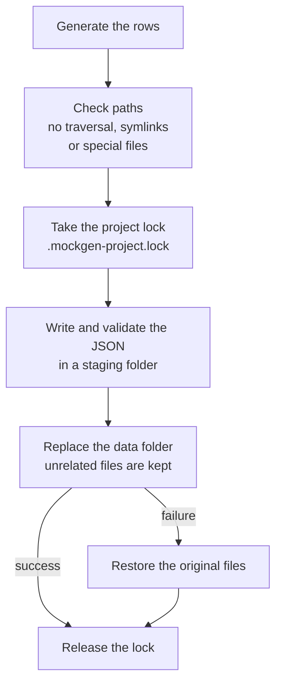
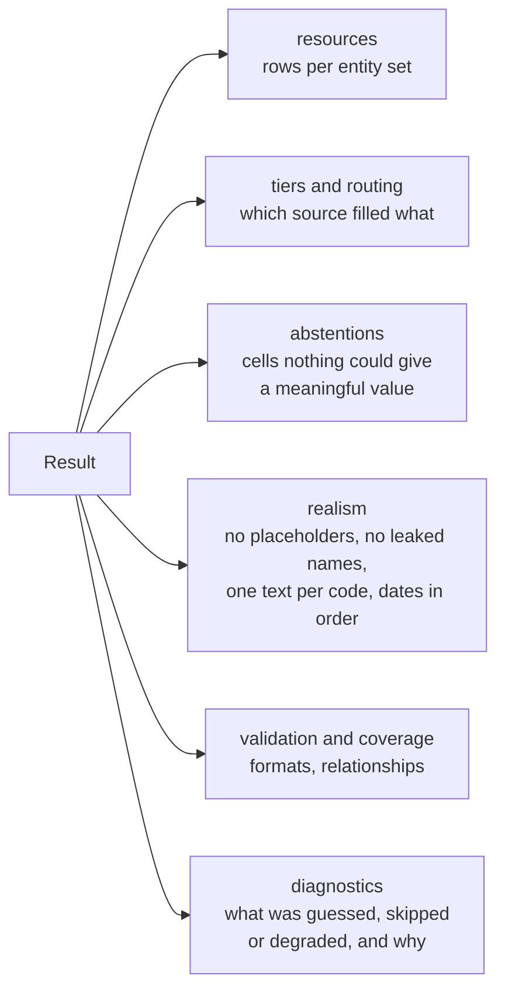
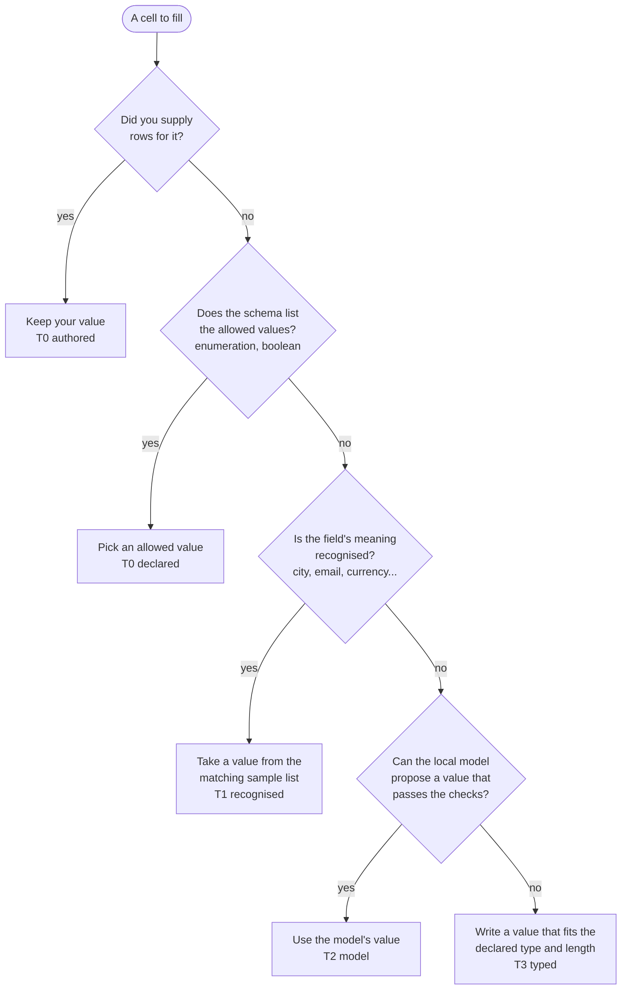
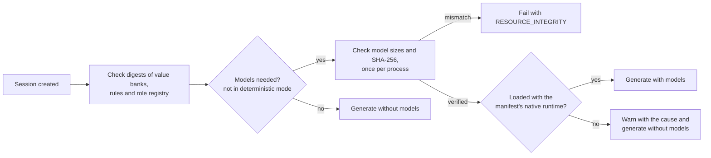

# `@sap-ux/mock-data-generator`

Create realistic test data for an OData service, on your own machine, without a backend and without sending anything to the cloud.

You give it the service metadata (EDMX or CSN). It gives you rows for each entity set: names that look like names, dates in the right order, codes with matching texts, and references that point to rows that exist. Everything runs offline. The package ships with a small field classifier, a small local language model and curated lists of sample values.

## Quick start

Use Node.js 22 or newer. Save this as `request.json` in the application root and run `mockgen generate --input request.json` from that directory. This deterministic example runs without the model files.

```json
{
    "projectRoot": ".",
    "dataDirectory": "webapp/localService/mockdata",
    "request": {
        "metadata": {
            "format": "csn",
            "content": "{\"definitions\":{\"Demo\":{\"kind\":\"service\"},\"Demo.Records\":{\"kind\":\"entity\",\"elements\":{\"ID\":{\"key\":true,\"type\":\"cds.Integer\"},\"Label\":{\"type\":\"cds.String\"}}}}}"
        },
        "service": { "urlPath": "/demo", "odataVersion": "4.0", "alias": "Demo" },
        "targets": [{ "name": "Records", "kind": "entity-set" }],
        "existingData": {}
    },
    "options": { "mode": "deterministic", "rowsPerEntity": 2, "seed": 1 }
}
```

This writes `webapp/localService/mockdata/Records.json`. Repeat runs append rows to the existing file. If a supplied snapshot disagrees with the file, generation leaves the file intact and reports a conflict.

To return the rows in memory, use the same request with the one-shot API:

```js
import { readFile } from 'node:fs/promises';
import { generateService } from '@sap-ux/mock-data-generator';

const { request, options } = JSON.parse(await readFile('request.json', 'utf8'));
const { resources } = await generateService(request, options);
console.log(resources.Records);
```

For repeated API calls, create a session with `createMockDataGenerator()` and call `dispose()` when finished. The one-shot `generateService()` and `inspectService()` manage their own sessions.

### Modes

| Mode            | What it uses                                                                               |
| --------------- | ------------------------------------------------------------------------------------------ |
| `deterministic` | Metadata, rules and sample lists only. Fast, the same output every time for the same seed. |
| `learned`       | Adds the field classifier and the local model.                                             |
| `auto`          | The default; behaves as `learned`.                                                         |

Missing or corrupt model files fail a `learned` or `auto` request with `RESOURCE_INTEGRITY`. A model that is intact but cannot load (for example without the native runtime) is reported with a warning, and generation continues without it.

### Common generation options

| Option                               | What it does                                                                    |
| ------------------------------------ | ------------------------------------------------------------------------------- |
| `rowsPerEntity`                      | Rows per entity set: one number, or a number per entity set.                    |
| `seed`                               | Same seed, same deterministic values.                                           |
| `referenceDate`, `windowYears`       | The calendar window dates are drawn from (`YYYY-MM-DD`, and 1 to 100 years).    |
| `sftBudgetMs`, `sftTimeoutMs`        | Time the local model may use for the whole service, and for one entity set.     |
| `sftDeadlineMs`                      | Time for the whole generation; the model gets what the earlier steps leave.     |
| `sftPriorityTargets`                 | Entity sets the model fills first, such as the ones the application shows.      |
| `sftModelRows`                       | Rows per entity set the model writes; the other rows reuse its values.          |
| `sftFieldsPerCall`                   | Fields the model writes per call. Fewer fields finish sooner on a slow machine. |
| `sampleDataset`, `syntheticScenario` | Your own sample texts, or explicit domains and consistency rules.               |

### Sessions and execution modes

A session (`createMockDataGenerator()`) accepts `onProgress`, an optional absolute `answerCacheDirectory`, an optional absolute [`resourceRoot`](#bundling-the-package), and an execution mode. Execution modes are time-budget presets named after the host's purpose: `api` (default) and `start-mock` apply no preset, and `data-editor` keeps the local model within the limits an interactive editor can wait for (the `DATA_EDITOR_SFT_*` limits in `src/limits.ts`). Options you pass yourself always win over a preset.

### Command line

`mockgen help`, `mockgen info` and `mockgen generate --input <request.json>`, where the input has the `generateProjectData()` shape. The command prints one JSON document to standard output; usage and error messages go through `@sap-ux/logger`. The request is checked before anything is generated, and an invalid value is reported with its JSON path. A cancellation signal cannot be given in JSON.

## Writing data into a project

`generateProjectData()` never leaves a project half-written.



Runs on the same project take turns through the lock directory next to the data folder; a lock left behind by an ended process on the same host is removed automatically. It does not edit application scripts or UI5 configuration.

## What you get back



The result also reports the execution mode actually used, which components were ready, and fingerprints of the request, so you can tell a reproducible result from one that depended on the model's time budget. Some things to keep in mind:

- Data that is valid in format is not proven valid for the business.
- `validation.relationships` is false when rows you supplied reference rows that do not exist; generated references always resolve.
- Inspection includes generated values only when you ask for them, and progress events never contain prompts or row values.
- Schema elements the generator does not support are left out, with a diagnostic.

The rows of one entity also agree with the rows they refer to and with the metadata:

- a property that repeats the referenced row's semantic key (`Common.SemanticKey`) holds that row's value, and semantic keys are unique in their entity set;
- in a country or currency entity, each row describes one country or currency, its code and name together;
- the unit field of a measured field (`Measures.Unit`) holds units of measure of the measured quantity's dimension;
- digit-sequence and upper-case fields (`Common.IsDigitSequence`, `Common.IsUpperCase`, `sap:display-format`) hold digits and upper case, and a country code in a digit-sequence field is the ISO 3166-1 numeric code;
- two dates or times of no known order follow the order the metadata declares them in, so they are never equal in every row.

Your own data, enumerations, value helps and explicit relationships always win over synthetic samples. A generated code list with texts is accepted only after an independent relevance check, and a model value for a field whose role is only a best guess is kept only when that role accepts it.

### Code lists in other services

An SAP Gateway service often declares its currency and unit code lists (`CodeList.CurrencyCodes`, `CodeList.UnitsOfMeasure`) in another service, such as `../../../../default/iwbep/common/0001/$metadata`. UI5 shows no amount or quantity whose code is missing from that list, and the mockserver serves the list only from local data files. To keep generated amounts visible, pass the referenced services:

```typescript
import { describeReferencedServices, generateService } from '@sap-ux/mock-data-generator';

// Folders are relative to the folder of the requested service's metadata, as the mockserver reads them.
const referencedServices = describeReferencedServices(request).map(({ folder, entitySets }) => ({
    folder,
    metadata: { format: 'edmx', content: readFileSync(join(metadataFolder, folder, 'metadata.xml'), 'utf8') },
    existingRows: readRows(join(metadataFolder, folder), entitySets) // your own reader of `<entitySet>.json`
}));
const result = await generateService({ ...request, referencedServices });
// result.referencedResources: [{ folder, entitySet, rows }], to write as `<folder>/<entitySet>.json`
```

Each changed code list comes back complete: its existing rows as written, then one row for each code the rows use that it lacks, with the name, fraction digits, standard code and external code its key annotations name. A code list that is declared but not passed is reported with `REFERENCED_SERVICE_UNAVAILABLE`; a code list that cannot be completed is reported with `REFERENCED_CODE_LIST_UNSUPPORTED`. `generateProjectData()` and the command line do not read referenced services yet, so they report the first diagnostic.

### Known limits

These are not detected or fixed, because nothing in the metadata says what is right:

- One number exceeding another (more booked seats than seats, a fee above its total).
- References that no navigation, referential constraint or value list declares.
- Whole numbers in a decimal field that has no recognised meaning (a count of decimals).
- A three-letter country code field: a field of length 3 may hold two-letter codes, so codes keep their two-letter form.
- Values of the wrong kind for their field (a person's name in a title field): a check that could find them flagged more good fields than bad ones, so it is not used. The release judge reviews them.
- Inside one model answer, two fields can disagree (an airport name and another city).
- A field of a child that has the same name as a field of the row it references (a bank number next to a bank key) is not copied from that row: a same name does not say the value is the same.
- Some value banks of place names are not keyed by country (district names), so such a field can name a place in another country than the row's.
- Meanings outside the role vocabulary get a generic value of their type (a birth date gets a recent date).

The SAP Fiori elements mockserver (`@sap-ux/fe-mockserver-core` 1.7 and 1.8) cannot read a single row of an OData V2 entity set whose key includes an `Edm.DateTime` property: it compares the `datetime'…'` literal of the request with the stored value as text, so they never match. The rows are listed, but opening one finds nothing. The generated rows are correct; the limit is in the mockserver.

## Errors and diagnostics

Failures you can act on throw `MockGenError` with a stable `code` from `MOCKGEN_ERROR_CODE` (exported with the `MockGenErrorCode` type), for example `REQUEST_INVALID` (request document, request or generation option), `METADATA_INVALID`, `CONFIGURATION_INVALID` (session options such as a relative `resourceRoot`), `CLI_USAGE`, `FILE_UNREADABLE`, `RESOURCE_INTEGRITY` (a shipped resource or model is missing, corrupt or does not match the manifest), `PROJECT_PATH_UNSAFE`, `PROJECT_LOCKED`, `PROJECT_DATA_CHANGED` and `PROJECT_RECOVERY_REQUIRED`. The underlying error is kept as `cause`. Messages for people are translatable and come from `src/translations/mock-data-generator.i18n.json` through i18next, so match on `code`, not on the message text. `TypeError` is left only for internal contract violations, as documented in `src/errors.ts`.

Diagnostics are not errors: they explain how a result was produced. `MockDataGeneratorDiagnostic.code` is the string-literal union `MockDataGeneratorDiagnosticCode`, and diagnostic messages are English technical text.

## Metadata formats

`format` is `edmx` or `csn`. When a CSN document defines services, one service is read and its entity sets carry CAP's OData names (`CatalogService.Books.texts` becomes `Books_texts`). The service is chosen by `service.alias` (qualified or short service name), otherwise by matching `service.urlPath` against the service's `@path` or CAP's default path, otherwise it must be the only service.

## Bundling the package

`resourceRoot` is an absolute directory laid out like the package's own `resources/` directory (`models/`, `banks/`, `rules/`). It is for hosts that bundle the package (for example with esbuild, as an ES module or CommonJS bundle): copy the whole `resources/` directory next to the bundle and pass that directory. `createMockDataGenerator()`, `getMockDataGeneratorInfo()` and `generateProjectData()` accept it; a relative path is rejected with `CONFIGURATION_INVALID`.

Everything is read from that directory: the model manifest, the model files, the value banks, the semantic rules and the role registry, and every data file is checked against the manifest's SHA-256 digests before it is read. Importing the package reads no resource file, so a bundle loads even where the package cannot find its own `resources/` directory. In a CommonJS bundle it never can, so a session without `resourceRoot` fails with `CONFIGURATION_INVALID` and a message that says to pass it.

A process uses one set of value banks, rules and registry, read on first use from the root of the first session (the package's own `resources/` when no session named one). A later session on another root is accepted only when that root holds byte-identical files, and is rejected with `CONFIGURATION_INVALID` otherwise.

## Generation details

### Where each value comes from

Every cell is filled by the first source that has a good answer. The sources are called tiers, and the result tells you how many cells each tier filled.



Rows you already have are kept exactly as you wrote them, fields left out included, and the requested rows are added after them, so a second run adds rows instead of replacing them. Your rows do not shape the new rows: whether they hold real data, placeholders from the standard mock server or hand-written test values, the new rows are planned and filled as they would be in an empty folder (a placeholder's row number still counts the rows before it). Your rows only decide what the new rows must fit: the keys they hold are taken, the rows you supply for a value list are its whole list, and new rows are linked to new parents, to your rows only when a parent set gains no new rows or a row shares its whole key with its parent. Your rows are still checked and reported, without being changed: a value-help value the value help does not list, or dates out of order. Rows of yours that share a key are kept too and reported with a `SUPPLIED_KEY_DUPLICATED` warning; the mock server returns the first of them for that key. New rows repeat no key, semantic key or alternate key of your rows, and new children are linked to the parents that have none first. The rows you supply for a value list are its whole list, so none are added there, and the set is reported with `ROW_COUNT_REDUCED_AUTHORED_DOMAIN`. A set never grows past 1,000 rows; a set that reaches the limit gets fewer new rows and a `ROW_COUNT_REDUCED_ROW_LIMIT` warning.

An entity type without an entity set that another row contains (OData V4 `ContainsTarget`) gets rows too, and they are written inside the rows that contain them, under the navigation property, as the SAP Fiori elements mock server reads them: a list for a to-many navigation, and a list of one row for a to-one navigation. The list of one row is how the mock server stores contained rows itself; its read of the navigation, and of what that row contains, fails on a single object when the container shares a key name with it, and it answers `$expand` of such a navigation with the list as stored, not a single row. Each new row of the requesting entity set holds at least one contained row before any holds two, contained rows hold contained rows of their own at any depth, and a contained row carries the values its container shares with it: the properties its referential constraint copies, or else the keys both declare by name. Rows you supply keep exactly what they contain. The rows of the draft administration navigation are left to the mock server.

Keys and foreign keys are generated so that every reference resolves. When nothing knows what a text field holds, it gets the value the standard SAP Fiori elements mock server would write, the property name and the row number (`BankNumber_3`), or a code of the name's initials in a column too short for the whole name, in upper case in an upper-case field and as a zero-padded number in a digit-sequence field. That is honest: it says plainly that the value is a placeholder, instead of pretending to be real.

### The local model and its time budget

The language model is the slowest part, so it only fills what the earlier tiers could not, and it runs inside a time budget. The entity sets the host names in `sftPriorityTargets` go first (an editor passes the ones the application displays); then code lists the model writes; then the rest, smallest first. The texts next to references are matched to the referenced rows afterwards, so this order never leaves a reference with another row's name. Each entity set may use what is left of the budget, and stops as soon as its fields are done, so the time it does not need goes to the next one. The model writes a few fields per call, so even a slow machine finishes some calls instead of none. Whatever the model does not reach keeps its earlier value.

The model's answers are kept in memory, and optionally on disk (`answerCacheDirectory`), so the same request is answered again without running the model.

The model writes a few rows per entity set, and the other rows reuse its values. A text column whose values name one record per row (distinct identifiers such as `B-0042`) is not repeated: the other rows get new numbers in the same form. Times, amounts and columns whose most likely role is not an identifier (a postal code) reuse the model's values. An e-mail or web address the model writes is moved to the reserved `example.com` domain, so mock data never names a real host.

## Resources and models

- The sample value lists live in `resources/banks/value-banks.v2.json`.
- The semantic rules (lexical rules, ABAP data elements, temporal and consistency vocabulary, model output filters, routing policy and thresholds) live in `resources/rules/semantic-rules.v1.json`, described by `semantic-rules.schema.json`.
- The role registry is `resources/rules/role-registry.v1.json`.
- The order of values and rules affects seeded output.
- `resources/models/manifest.json` pins all of them and every model file by SHA-256. After changing any of them, regenerate it as described in [model supply](docs/model-supply.md#rebuilding-and-checking-the-manifest).

The classifier and the local model are English-only. How the model files are built, verified and released is in [model supply](docs/model-supply.md); how they are trained is in [training](training/README.md).



## Further reading

- [Model supply](docs/model-supply.md): which model files are tracked or built, how integrity is verified, how the manifest is regenerated and how the package is released.
- [Model licenses and provenance](docs/model-licenses.md): redistribution requirements.
- [Data and heuristics design record](docs/design/data-and-heuristics.md): where each kind of data lives, the specification behind the remaining constants in code, the known limits of each heuristic and the determinism guarantees.
